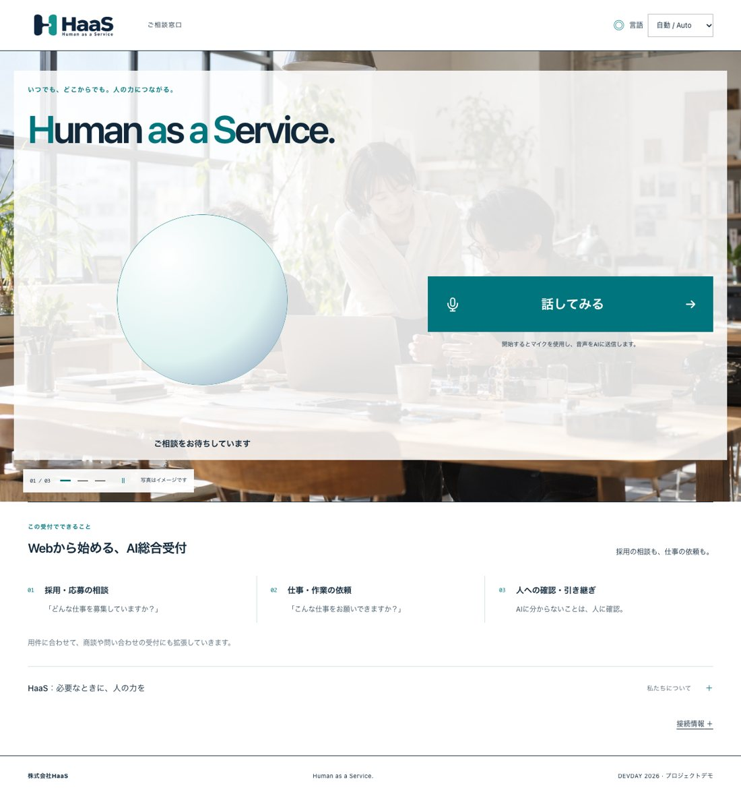
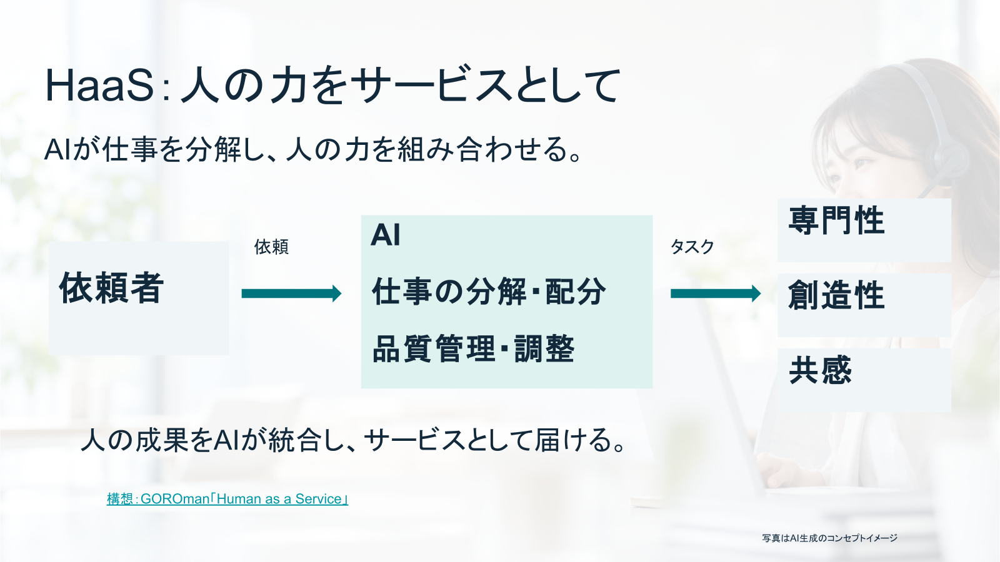
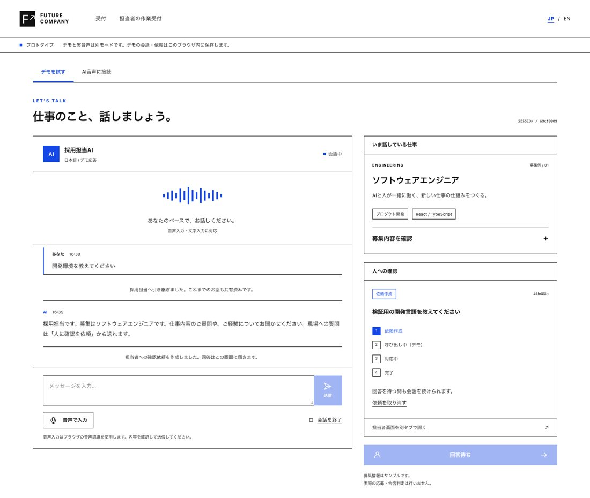
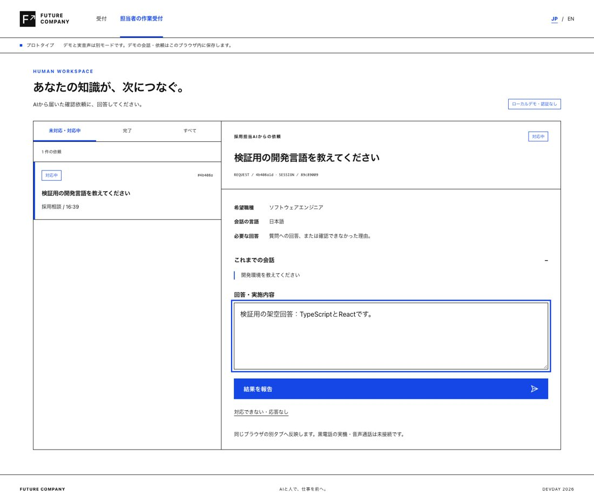
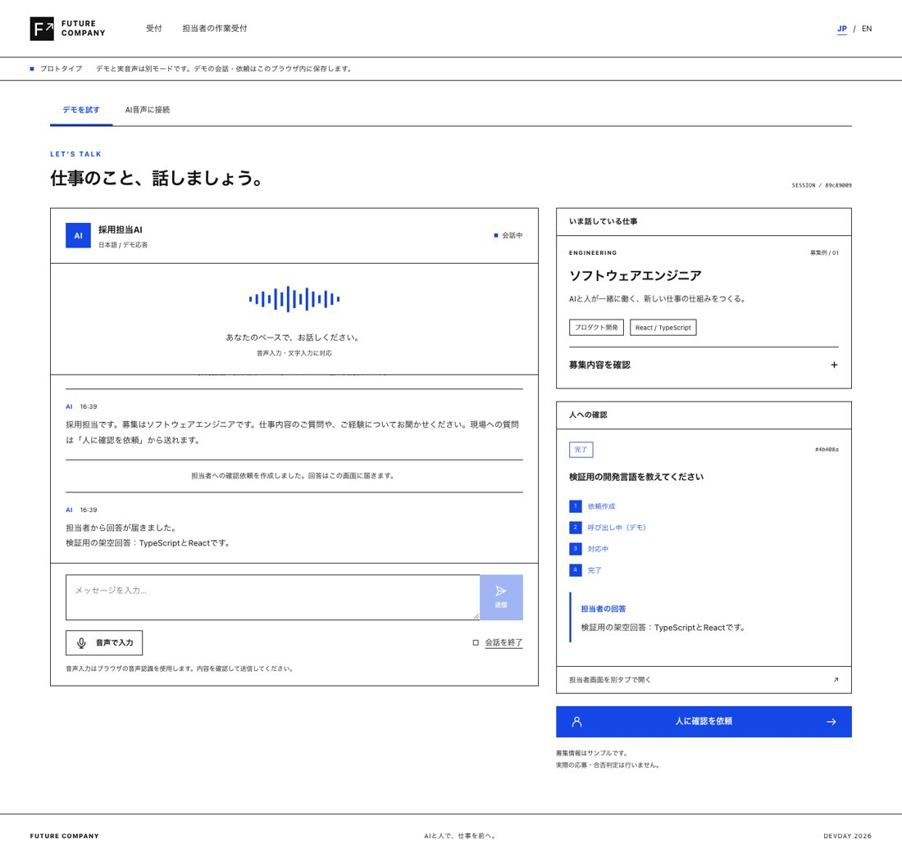
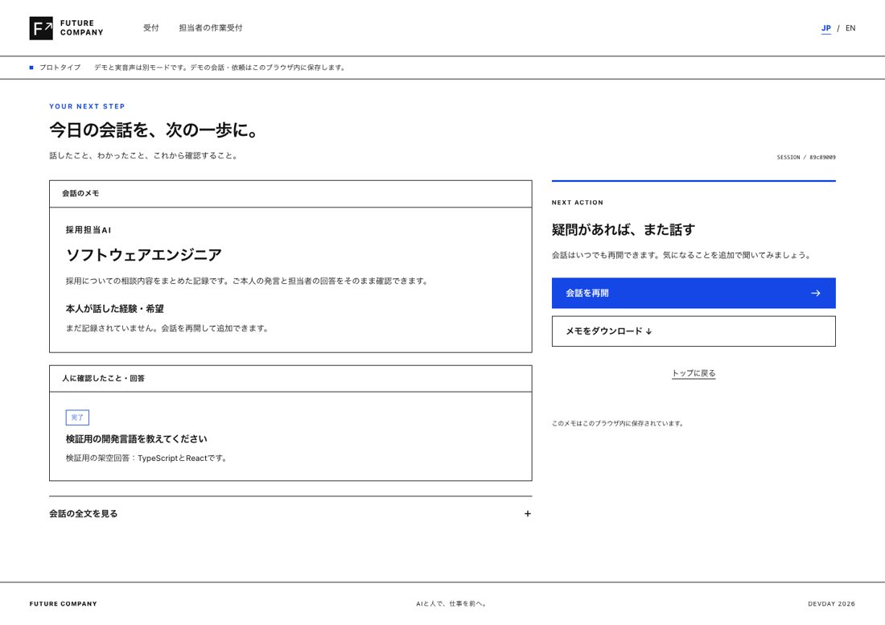
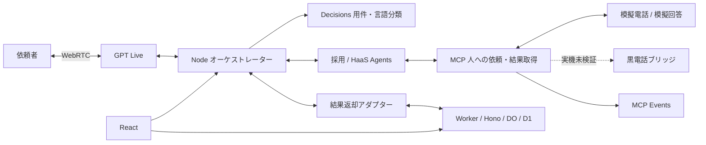

# Team HaaS — Human as a Service


**AIの『できない』を、人の出番に。**

人がAIを使う日常から、AIが必要な人の能力を呼び出す仕事の形へ。依頼をAIが整理・分解し、人の専門性・創造性・共感を組み合わせ、成果を依頼者へ届ける構想です。採用受付を最初の実装例にしています。

DevDay Community Hackathon 2026 の提出用モノレポです。[app/](app/) にReact、音声・業務Agent、MCP、Workerのソース・テスト・検証記録を同梱しています。資料中の「株式会社HaaS」はプロジェクト上の表現です。

## 1. DevDay新機能活用

GPT Liveを音声の入口に、Decisionsで用件・言語を分類し、AgentsからMCPへ人の作業を依頼します。例えばHaaSの技術確認を人へ渡し、模擬回答を元のAgentとLiveへ戻す経路を検証しています。

根拠：[業務Agent](app/integration/backend.mjs)、[Live](app/integration/live-session.mjs)、[MCP](app/integration/human/)、[実API試験記録](app/integration/VERIFICATION.md)。[MCP Events](app/integration/events/)は購読・署名・再送の実装とローカル試験があり、実ChatGPT Work/dotsの購読は別の確認対象です。

## 2. 使いやすさ



受付の入口をまとめ、会話・担当・依頼・回答の状態を表示します。担当者は引受・回答を操作し、利用者は結果を元の会話で受け取ります。

根拠：[React受付](app/frontend/src/pages/ReceptionPage.tsx)、[接続クライアント](app/frontend/src/features/live/client.ts)、[UI試験](app/frontend/tests/)、下記の公開模擬デモ。利用者調査や定量的な操作性評価は未実施です。

## 3. 有用性

AIだけでは確定できない質問や作業を、人へ具体的な依頼として渡します。誰に・何を・どんな結果を求めるかを整理し、人の回答が質問に答えているかを照合する試作です。

根拠：[依頼仕様](app/integration/human/README.md)、[技能候補](app/integration/human/experts.mjs)、[案件API](app/src/backend/api.ts)、[結果返却](app/integration/worker-bridge.mjs)。実Agentsの1シナリオでは、無関係な模擬回答を作業成功としないことを確認した記録があります。時間削減や品質改善の実測ではありません。

## 4. 独創性

人をAIの代わりに使う発想ではなく、人が持つ能力をAIが仕事として組み合わせるHaaSを主軸にしています。黒電話を人への依頼の接点として構想し、採用以外の仕事にも共通の依頼・結果返却経路を用意しました。

根拠：[全体設計](app/integration/ARCHITECTURE-1445.md)、[模擬電話](app/integration/human/simulate-phone.mjs)、[HaaS経路の試験](app/integration/orchestration.test.mjs)。実機ベル・実通話・報酬支払いの成功は主張しません。

将来は、疑わしい相談を信頼できる人や専門窓口へつなぐ詐欺被害防止、AIだけで抱えず訓練を受けた人へつなぐ有人相談支援を想定しています。いずれも将来構想で、実装済み機能・成果保証・実在サービスとの提携ではありません。危機相談をAIが代替する主張はしません。



## すぐ試す：公開の模擬UI

[公開フロントデモ](https://future-company-fe-preview.aliceroad123.chatgpt.site/) はインストール不要です。

1. 「AI受付と話す」から会話を開始し、文字で開発環境などを質問。「人に確認を依頼」から架空の質問を送ります。
2. 同じブラウザの別タブで[担当者画面](https://future-company-fe-preview.aliceroad123.chatgpt.site/operator)を開き、模擬呼出し・引受・架空の回答・結果報告を試します。
3. 元の会話への回答反映、終了後のメモを確認します。取消・応答なしも試せます。

これはlocalStorageによる模擬動作で、別ブラウザ・別端末には同期しません。公開先のUIは更新される場合があります。[模擬UIのソース](app/frontend/src/LegacyPrototype.tsx)と[状態テスト](app/frontend/tests/demo.test.ts)も同梱しています。実AI・実通話とは分けて確認し、実在する応募者の個人情報は入力しないでください。`haas.nullevi.app` はクッションページを準備中で未稼働です。

## このリポジトリから起動

Node.js **24.14以上の24系**とnpmを使います。Workerの一部テストにはBunも必要です。

```sh
git clone https://github.com/GOROman/devday-community-hackathon-2026-haas.git
cd devday-community-hackathon-2026-haas/app
npm ci
npm run db:migrate:local
npm run dev
```

入口は `http://127.0.0.1:5173/`。React（5173）、Node音声（4320）、Worker（8787）を起動し、設定済みなら認証付きrelay（4330）も起動します。ローカルWorkerは[wrangler.local.jsonc](app/wrangler.local.jsonc)を使います。

実音声には[.env.example](app/.env.example)のサーバー側OpenAI設定、外部から到達できる認証付きMCP、Workerの社員認証・relay設定が必要です。設定不足なら音声開始を止めます。[環境・起動説明](app/README.md)、[Worker接続条件](app/docs/backend-integration.md)、[結果返却仕様](app/docs/worker-result-bridge.md)を参照してください。キーはブラウザ変数・URL・コミットに入れません。本番設定ファイルは実環境の値を含まないプレースホルダーにしています。

| コマンド（app/内） | 確認対象 |
| --- | --- |
| `npm run test:frontend` | UI状態、接続、担当切替、音量、録音処理 |
| `npm run integration:test` | Node、MCP、依頼・回答、通信・終了処理 |
| `npm run test:worker` | 認証・案件・DO/D1・結果返却境界（Bunも必要） |
| `npm run typecheck` | ReactとWorkerの型 |
| `npm run build` | ReactとWorkerのビルド |

提出コミット `4b4599d` をNode24.14で実行し、**自動テスト252件、型チェック、React・Workerのビルド、ローカル起動に成功**しました。Chromeでは同梱の保管模擬UIで依頼・引受・回答・会話反映・終了・再読込を確認。現行音声受付はrelay未設定のHTTP503で停止し、実AI開始は0件です。[実測記録と条件](docs/submission-verification.md)を参照してください。

## 実画面での依頼と回答

以下は公開サイトではなく、同梱の保管模擬UIをローカル専用fixtureで実操作した画面です。すべて架空データです。









## 構成



同梱コードの接続構成です。公開の模擬UIが全体を実接続していることを意味しません。

## 検証記録と再現範囲

[今回の提出コードの実測](docs/submission-verification.md)：フロント89件、音声/MCP86件、Worker77件。lintはerrorなし・既存warning9件、ビルドにはチャンクサイズ等のwarningがあります。下表は各担当者が残した別試行の記録です。

| 記録 | 確認された範囲 | 条件・限界 |
| --- | --- | --- |
| [音声・Agents・MCP](app/integration/VERIFICATION.md) | 採用/HaaS個別経路、単一HaaS音声、調査・依頼・回答照合 | 合成音声・実API・模擬人間回答。実マイク・実人間の通話とは区別 |
| [UI・Worker結合](app/docs/review-integration-verification.md) | 案件作成、所有者認証、案件限定証明と取消、Worker68件・FE57件等の担当者記録 | Node・公開relay・実Liveまでの全体通しの完了は示していません |
| [ローカル音声確認](app/docs/local-voice-demo-verification.md) | 現行起動経路の確認記録 | 認証・実API・ブラウザ権限など、各試行の条件を参照 |
| [オーブ表示](app/frontend/ORB-VERIFICATION.md) | 会話状態と音量表示 | 見た目・模擬入力から実通話成功は推定しません |

単一HaaS音声の成功試験は3,319音声フレーム、非無音1,658、受信エラー0、終了時 `live_finalized=true` と記録されています。人間側は架空のTypeScript/React等の模擬回答です。3担当の連続声切替では中断した試行があり、個別経路から全体成功へ一般化しません。採否の自動決定・候補者評価・順位付けは対象外です。

## 作品資料とチーム

[作品説明PDF](docs/slides-preview.pdf) / [説明テキスト](docs/presentation.md) / [構想の原典](https://note.com/goroman/n/n8867b4737495)。ロゴと写真は生成画像です。

Team HaaS：りも＝開発リード・API連携、pupuchan＝フロントエンド、r74＝バックエンド、GOROman＝PM・プレゼン資料・ハードウェアハッカー。

行動指針：頼る判断も、知性である。人の判断に、敬意と対価を。任せた先まで、やりきる。

取り込み元・採用コミット・第三者ライセンスは[ソース来歴](docs/source-provenance.md)に記載しています。
