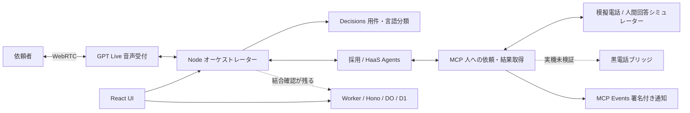

# Team HaaS — Human as a Service


**AIの『できない』を、人の出番に。**

AIが依頼を整理し、必要な人へ仕事を渡し、回答・成果を依頼者へ届けるハッカソンのプロトタイプです。人の専門性・創造性・共感を必要な単位で使えるというHaaS構想を、最初の例として採用受付で検証しています。

このリポジトリは DevDay Community Hackathon 2026 の提出資料用です。開発コードの正本は [pupuchan1/future-company](https://github.com/pupuchan1/future-company) にあります。資料中の「株式会社HaaS」はプロジェクト上の表現で、法人設立済みという主張ではありません。


## 今回作ったもの

- **依頼者と担当者のUI**：人への質問を作成し、引受・模擬回答を元の会話へ戻す流れ。
- **実AIを使う音声・業務プロトタイプ**：GPT Live、Decisions、Agents、MCPによる相談と結果返却。実APIの成功記録は単独経路と模擬人間回答の範囲です。
- **案件保存と認証のバックエンド**：Workers・Hono・DO/D1。公開UIを含む全体の通しと黒電話は未検証です。


実装の根拠は下記の公開コード・固定コミットと担当者の検証記録へリンクしています。

## 4つの評価軸に対応する設計と証拠

| 評価軸 | 今回の設計 | 確認できる証拠と限界 |
| --- | --- | --- |
| DevDay新機能活用 | GPT Liveを入口に、Decisionsで用件・言語を分類し、AgentsからMCPへ人の作業を依頼。MCP Eventsの署名・再送も実装 | 実API試験とローカル試験の記録を下記にリンク。実購読者と実機の通しは未確認 |
| 使いやすさ | 依頼者の入口をまとめ、担当・依頼・回答の状態を表示。担当者には引受・回答の操作を用意 | 公開の模擬UIで確認可能。利用者調査・定量的な操作性評価は未実施 |
| 有用性 | AIだけでは確定できない質問や作業を人へ渡し、結果を元の会話へ戻す | 採用受付と技術確認で試作。効果・時間削減・品質改善の実測はありません |
| 独創性 | 人の能力をAIが組み合わせるHaaSを主軸に、黒電話を人への依頼の接点として構想 | 採用は一例。実ベル・通話・報酬支払い・汎用人材市場は未実装または未検証 |

## デモ手順（模擬UI、約3分）

1. [公開デモ](https://future-company-fe-preview.aliceroad123.chatgpt.site/) を開き、「AI受付と話す」から会話を開始します。
2. 文字入力で開発環境などを質問し、「人に確認を依頼」から質問を送ります。
3. 同じブラウザの別タブで [担当者画面](https://future-company-fe-preview.aliceroad123.chatgpt.site/operator) を開きます。
4. 模擬の呼出し状態を試し、「引き受ける」から架空の回答を入力して「結果を報告」します。
5. 元の会話タブへの回答反映を確認し、会話終了後にメモ・未解決事項を確認します。取消・応答なしも試せます。

この手順はスライドと[フロント試作README](https://github.com/pupuchan1/future-company/blob/4cbf25ad311e7292cc1b23b801e217151087548a/frontend/README.md)に基づきます。公開先は更新されるため、UIが異なる場合はその版の案内に従ってください。別ブラウザ・別端末には同期されません。実在する応募者の個人情報は入力せず、架空データで体験してください。

## 何を確認できるか

| 対象 | 現在の状態 | 根拠・制約 |
| --- | --- | --- |
| 公開フロントUI | 模擬会話、人への依頼、担当者の引受・模擬回答、結果表示 | 同一ブラウザのlocalStorageで同期。実AI・電話の接続成功を意味しません |
| 実AI APIと模擬人間回答 | Node単独で単一HaaS音声の往復を検証した記録あり | 合成音声入力、実WebRTC・Agents・MCP、模擬電話の範囲 |
| 仕事の調査・人への依頼・回答照合 | 実Agents APIによる1シナリオの検証記録あり | 無関係な模擬回答を成功としないことを確認。全タスクの品質保証ではありません |
| Workerの案件保存・認証 | DO/D1と案件限定証明のローカル結合試験の記録あり | Node・実Live・公開relayまでの通しとは区別します |
| 実機の黒電話・人間との音声通話 | 未検証 | ベル鳴動、受話器検知、実人間の回答・双方向中継の成功は主張しません |

## 資料と入口

- [公開フロントデモ](https://future-company-fe-preview.aliceroad123.chatgpt.site/)：ブラウザ内の模擬応答で操作を試すUI。
- [詳細版Google Slides（全10枚）](https://docs.google.com/presentation/d/1KRTMFYQiLugfNoKXPJWCc3JFyjXT8NkxEPqvpC5EvUY/edit)：元の内容・順序を保持した資料。
- [別デッキの3分本編（6枚）](https://docs.google.com/presentation/d/1nZfflzDYlQgFWedtzofWIgupZD2inLphNzmtGdWG_XA/edit)：所有者限定のまま作成。
- [3分本編の公開PDF](docs/slides-3min-preview.pdf) / [180秒の配分と発表メモ](docs/presentation-3min.md)：審査・閲覧用。
- [全10ページのプレビューPDF](docs/slides-preview.pdf)：公式プレビュー画像をまとめた画像版。
- [プレゼンの表示テキスト](docs/presentation.md)：検索・読み取り用の全ページテキスト。
- [構想の原典（GOROmanのnote）](https://note.com/goroman/n/n8867b4737495)：AIが人的サービスの分解・配分・品質管理・調整を担う広い構想。将来像を含み、今回の実装範囲とは区別します。
- [ロゴ・社訓の提案PR #62](https://github.com/pupuchan1/future-company/pull/62)：ロゴは生成画像です。

`https://haas.nullevi.app/` は準備中で、クッションページを別作業で用意しています。現時点では未稼働です。デモには上記の公開フロントURLを使ってください。

## 3分プレゼン本編

本編は詳細版とは別のデッキです。計180秒はデモのタブ切替を含む進行案で、発表時間を実測した結果ではありません。詳細チーム紹介・技術構成・行動指針は詳細版に残しています。

| 順 | 内容 | 目安 |
| --- | --- | ---: |
| 1 | 表紙・Team HaaS | 15秒 |
| 2 | HaaS構想 | 25秒 |
| 3 | 仕組みの編集可能な図 | 35秒 |
| 4 | 採用受付デモ（切替込み） | 60秒 |
| 5 | 価値と実装境界 | 25秒 |
| 6 | 締め | 20秒 |

[本編PDF](docs/slides-3min-preview.pdf) / [発表メモ](docs/presentation-3min.md)。Google Slidesのノートにも各ページの配分・発表メモ・詳細版のURLを記載しています。

## 構成と実装境界



これはコードの構成と接続境界です。公開フロントデモはlocalStorageの模擬動作で、この全構成が公開先で一体動作していることを示す図ではありません。MCP Eventsの実ChatGPT Work/dots購読も別の検証項目です。

## 実装・検証の証拠

以下は取得時点の固定コミットへのリンクです。担当者が記録した検証結果の読み取りであり、この提出資料作成時に実API試験を再実行したものではありません。開発リポジトリは公開状態を確認し、検証記録の固定コミットURLにも未認証でHTTP 200を確認しました。本リポジトリへのコード複製は行っていません。

- [統合ブランチの起動手順・接続境界](https://github.com/pupuchan1/future-company/blob/aa635e317f90f7c78a483b4311ca163bfc6d1f12/README.md)：React・Node・Workerを同じcheckoutで起動する構成。
- [音声・Agents・MCPの検証記録](https://github.com/pupuchan1/future-company/blob/aa635e317f90f7c78a483b4311ca163bfc6d1f12/integration/VERIFICATION.md)：14:42の採用/HaaS個別試験、15:30の単一HaaS音声再確認、調査・回答照合試験。
- [Nodeの業務Agent実装](https://github.com/pupuchan1/future-company/blob/aa635e317f90f7c78a483b4311ca163bfc6d1f12/integration/backend.mjs)：依頼の具体化、元担当への回答返却、模擬データの明示。
- [MCP・機器境界](https://github.com/pupuchan1/future-company/tree/aa635e317f90f7c78a483b4311ca163bfc6d1f12/integration/human)、[MCP Events](https://github.com/pupuchan1/future-company/tree/aa635e317f90f7c78a483b4311ca163bfc6d1f12/integration/events)：実装とテスト。
- [Worker・FE結合の検証記録](https://github.com/pupuchan1/future-company/blob/aa635e317f90f7c78a483b4311ca163bfc6d1f12/docs/review-integration-verification.md)：案件作成・所有者認証・証明発行と取消をローカルで試験。Worker68件・FE57件等の担当者記録あり。
- [PR #28](https://github.com/pupuchan1/future-company/pull/28)、[Issue #19](https://github.com/pupuchan1/future-company/issues/19)、[実機のIssue #34](https://github.com/pupuchan1/future-company/issues/34)：統合と残件の追跡先。

単一HaaS音声の成功試験は3,319音声フレーム、非無音1,658、受信エラー0、終了時 `live_finalized=true` と記録されています。人間回答は架空のTypeScript/React等の回答です。ブラウザの実マイク・人による聴取・黒電話との試験ではありません。3担当の連続声切替では中断した試行があり、個別経路の成功から全経路成功へ一般化しません。

### 開発環境での再現

詳細な環境変数と境界は上記の統合READMEを参照してください。Node.js 24.14以上の24系と、Worker試験にはBunが必要です。

```sh
git clone https://github.com/pupuchan1/future-company.git
cd future-company
git checkout aa635e317f90f7c78a483b4311ca163bfc6d1f12
npm ci
npm run db:migrate:local
npm run dev
```

入口は `http://127.0.0.1:5173/`。実音声にはサーバー側のOpenAI設定、認証付きで外部から到達できるMCP、Workerの社員認証設定等が必要です。設定が不足する場合は開始不可になる設計です。`.env.example` を確認し、認証情報をブラウザ変数・URL・コミットに含めないでください。

試験コマンドは `npm run test:frontend`、`npm run integration:test`、`npm run test:worker`、`npm run typecheck`、`npm run build`。上記は手順の案内であり、今回の提出資料作成時の実行結果ではありません。

## 未検証事項と次の接続点

- 公開UI・Node・Worker結果アダプター・実Liveを一体にした通し動作。
- 3担当の連続した声切替と、実マイク・実スピーカーでの聞き取り。
- 黒電話の実ベル、受話器検知、人間の音声経路、切断からの復旧。
- 実ChatGPT Work/dotsによるMCP Eventsの購読と、その後の業務実行。
- 幅広い仕事への品質評価、実人材の割当、対価支払いと実運用。
- `haas.nullevi.app` のクッションページとDNS・TLSの公開確認。

採否の自動決定・候補者の評価や順位付けは今回の対象に含めません。

## Team HaaS

| メンバー | 担当 |
| --- | --- |
| [りも @vibe_walking](https://x.com/vibe_walking) | 開発リード・API連携 |
| [pupuchan @Pupuchan_geek](https://x.com/Pupuchan_geek) | フロントエンド |
| [r74 @r74tech](https://x.com/r74tech) | バックエンド |
| [GOROman](https://x.com/GOROman) | PM・プレゼン資料・ハードウェアハッカー |

行動指針：頼る判断も、知性である。人の判断に、敬意と対価を。任せた先まで、やりきる。

## 資料の状態

2026-10-18に読み取り・取り込み。詳細版Google Slidesは10ページを保持し、3分本編は別デッキの6ページです。PDFの直接エクスポートはファイル参照がMacへ実体化されず失敗したため、公式プレビュー画像から閲覧用PDFを作成し、表示テキストをMarkdownに保存しました。PDFは編集可能な原稿・検索可能な文字PDFではありません。スライドの実プロフィール画像は維持していますが、丸型への統一は未完了です。元資料は上記Google Slidesを参照してください。
