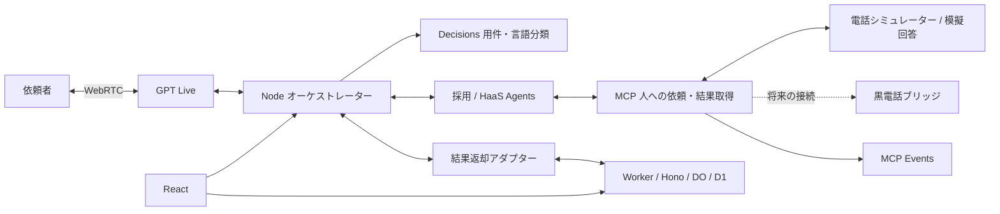

# Team HaaS — Human as a Service


**AIの『できない』を、人の出番に。**

AIが答えを確定できないとき、人への確認まで仕事を進める音声受付です。相談を分類し、必要な技能を探し、「誰に・何を・何を返してほしいか」を依頼として具体化。人の回答を元のAgentと音声会話へ返します。採用受付と、採用以外の技術確認を実装例にしています。

**確認済みの成果**

- **実APIで回答返却まで接続**：React受付 → GPT Live → HaaS Agent → 認証付きMCP → 模擬人間回答 → Workerへの保存 → 元のAgent・Liveへの反映と終了を、同じ案件で確認した[チームの結合記録](app/docs/local-voice-demo-verification.md)があります。入力は合成音声、人間側は電話シミュレーターです。
- **回答内容を照合**：実Agentsの技術調査シナリオでは、依頼と無関係な模擬回答を作業成功にせず、未回答と判断した[記録](app/integration/VERIFICATION.md)があります。
- **ローカルで再現できる自動検証**：フロント89件、音声・MCP86件、Worker77件、計**252件**とReact・Workerの型チェック・ビルドが成功。[提出時の実測](docs/submission-verification.md)と[fixでの再検証](docs/fix-verification.md)を分けて記載しています。自動テストは外部APIや電話を使わない回帰試験です。

[**公開デモ入口**](https://haas.nullevi.app/) · [作品説明PDF](docs/slides-preview.pdf) · [ソースコード](app/) · [検証・再現手順](#ローカルで再現する)

DevDay Community Hackathon 2026の作品リポジトリです。提出版はタグ [`submission-2026-10-18`](https://github.com/GOROman/devday-community-hackathon-2026-haas/tree/submission-2026-10-18) に保存し、この `fix` ブランチでは説明と再現性を改善しています。タグはユーザー指定時点の状態を保存したもので、実際の審査対象コミットとの同一性を示すものではありません。


## ４つの評価軸と実装の根拠

### 1. DevDay新機能活用：音声・判断・業務実行を人への依頼につなぐ

GPT Liveを音声の入口にし、Decisionsが用件と言語を分類、採用/HaaSのAgentsがMCPを通じて技能検索・人への依頼・結果取得を行います。回答は依頼元セッションへ戻し、利用者の言語を保って説明します。

- 実装：[Live接続](app/integration/live-session.mjs)、[業務Agent](app/integration/backend.mjs)、[MCPと人への依頼](app/integration/human/)、[結果返却アダプター](app/integration/worker-bridge.mjs)。
- 自動検証：[分類・言語保持・結果の重複配送防止](app/integration/orchestration.test.mjs)、[Worker接続](app/integration/worker-bridge.test.mjs)。`npm run integration:test` で再現できます。
- 実接続の根拠：[React・実API・Workerを同一案件で結合した記録](app/docs/local-voice-demo-verification.md)。MCP Eventsも[署名・購読・有限再送の実装と試験](app/integration/events/)を同梱しています。実ChatGPT Work/dotsでの購読は今後の確認対象です。

### 2. 使いやすさ：入口を一つにし、会話の連続性を保つ

利用者は共通受付から相談し、用件・言語に合わせて担当へつながります。担当の声を切り替える処理では、接続準備と有効化を待ち、失敗時には元の会話へ戻す設計です。終了時には録音・接続をまとめて解放します。

- 実装：[React受付](app/frontend/src/pages/ReceptionPage.tsx)、[Liveクライアント](app/frontend/src/features/live/client.ts)。
- 自動検証：[切替成功・失敗・取消・再送・録音の継続](app/frontend/tests/live-handoff.test.ts)、[会話・接続等のUI試験](app/frontend/tests/)。`npm run test:frontend` で再現できます。
- 実操作の根拠：[合成音声を使ったReact受付の結合記録](app/docs/local-voice-demo-verification.md)。これは接続・状態遷移の確認で、利用者調査による使いやすさの評価は今後の課題です。

### 3. 有用性：確認が必要な仕事を具体化し、回答を元の相談へ戻す

「バックエンド担当者に開発言語とフレームワークを聞いてほしい」という相談を、人への依頼と期待する回答に変換。Worker側で案件・担当者・回答の版を管理し、元の相談へ返します。無関係な回答を受け取った場合も、依頼を達成したかを照合します。

- 実装：[依頼仕様](app/integration/human/README.md)、[技能候補](app/integration/human/experts.mjs)、[案件API](app/src/backend/api.ts)、[回答返却](app/integration/worker-bridge.mjs)。
- 自動検証：[案件・認証境界](app/src/backend/api.test.ts)、[結果返却の結合試験](app/src/backend/bridge.integration.test.ts)、[NodeとWorkerの結合](app/integration/worker-bridge.test.mjs)。`npm run test:worker` と `npm run integration:test` で再現できます。
- 実接続の根拠：冒頭の同一案件の回答返却と、[無関係な回答を未達成とした実Agentsの１シナリオ](app/integration/VERIFICATION.md)。時間削減や品質向上の定量評価は今後行います。

### 4. 独創性：人の専門性・創造性・共感をAIが仕事として組み合わせる

人がAIを使うだけでなく、AIが必要な人の能力を呼び出す **Human as a Service** が中心です。採用専用の固定フローを越えて、技術確認などにも共通の依頼・回答経路を用意しました。黒電話は、その人への依頼を身近な道具で受け取る接点として構想しています。

- 実装：[全体設計](app/integration/ARCHITECTURE-1445.md)、[模擬電話](app/integration/human/simulate-phone.mjs)、[人側サービス](app/integration/human/)。
- 自動検証：[依頼元への返却](app/integration/orchestration.test.mjs)、[人側サービスとシミュレーター](app/integration/human/)。`npm run integration:test` で再現できます。
- 実装範囲：ソフトウェア上の電話シミュレーターまで。黒電話の実機ベル・実通話・報酬支払いは将来の接続対象です。

## 公開デモと検証条件

入口は **https://haas.nullevi.app/**、現在の案内先は https://future-company-voice-node.r74.workers.dev/ です。受付を開き、マイク利用・音声送信の説明を確認してから操作してください。実音声の動作にはサーバー側のAPI・認証・relay設定が必要です。

検証対象は次のように区別しています。今回のfixで外部通話・有料APIは実行していません。

| 対象 | 確認済みの範囲 | 証拠・条件 |
| --- | --- | --- |
| 同梱コードの回帰試験 | 252件、型チェック、React・Workerビルド | [fix再検証](docs/fix-verification.md)。外部API・実電話なし |
| チームの実API結合 | React・Live・Agent・MCP・Worker・回答返却・終了 | [結合記録](app/docs/local-voice-demo-verification.md)。合成音声・模擬人間回答 |
| 公開画面の過去の撮影 | 旧公開UIの操作と、その後のLive画面の初期表示 | [公開mock撮影記録](docs/submission-verification.md)、[Live画面撮影記録](docs/public-live-capture.md)。現在の転送先での通し実演とは別の記録 |

単一HaaS音声の別試行では3,319音声フレーム、非無音1,658、受信エラー0、終了時 `live_finalized=true` を記録しています。[試行別の詳細](app/integration/VERIFICATION.md)には、途中で中断した複数担当切替も残しています。実マイク・実人間との通話・公開環境全体の安定動作は今後の実証項目です。採否の自動決定・候補者評価・順位付けは対象外です。

## ローカルで再現する

Node.js **24.14以上の24系**、npm、Workerの一部テスト用のBunが必要です。

```sh
git clone --branch fix https://github.com/GOROman/devday-community-hackathon-2026-haas.git
cd devday-community-hackathon-2026-haas/app
npm ci --ignore-scripts --no-audit --no-fund
npm run test:frontend
npm run integration:test
npm run test:worker
npm run typecheck
npm run build
```

上記は外部APIの資格情報なしで実行する回帰試験です。テストにはローカルHTTPサーバーの起動が含まれます。

画面とローカル開発サービスを起動する場合：

```sh
npm run db:migrate:local
npm run dev
```

入口は `http://127.0.0.1:5173/`。React（5173）、Node音声（4320）、Worker（8787）を起動し、設定済みなら認証付きrelay（4330）も起動します。音声設定なしでも画面を確認でき、音声開始は `voice_relay_unconfigured` で停止します。

実音声に必要な設定は[環境・起動説明](app/README.md)、[サーバー側環境変数の例](app/.env.example)、[Worker接続条件](app/docs/backend-integration.md)、[結果返却仕様](app/docs/worker-result-bridge.md)を参照してください。外部から到達できる認証付きMCPも必要です。キーはブラウザ変数・URL・コミットに入れず、本番設定には環境の値を設定してください。同梱の本番設定ファイルはプレースホルダーです。

| コマンド（app/内） | 確認対象 |
| --- | --- |
| `npm run test:frontend` | UI状態、担当切替、接続、音量・録音処理 |
| `npm run integration:test` | Node、MCP、人への依頼・回答、通信・終了処理 |
| `npm run test:worker` | 認証・案件・DO/D1・結果返却境界 |
| `npm run typecheck` / `npm run build` | ReactとWorkerの型・ビルド |

## 構成



## 将来の展開・作品資料・チーム

専門性・創造性・共感を必要な単位で届ける構想を、疑わしい相談を信頼できる人へつなぐ詐欺被害防止や、訓練を受けた人への有人相談支援へ広げることを想定しています。これらは将来構想で、実装・提携・成果の実証はこれからです。

[作品説明PDF](docs/slides-preview.pdf) / [説明テキスト](docs/presentation.md) / [構想の原典](https://note.com/goroman/n/n8867b4737495)。資料中の「株式会社HaaS」はプロジェクト上の表現です。ロゴと写真は生成画像です。

Team HaaS：りも＝開発リード・API連携、pupuchan＝フロントエンド、r74＝バックエンド、GOROman＝PM・プレゼン資料・ハードウェアハッカー。

行動指針：頼る判断も、知性である。人の判断に、敬意と対価を。任せた先まで、やりきる。

取り込み元・採用コミット・第三者ライセンスは[ソース来歴](docs/source-provenance.md)に記載しています。
